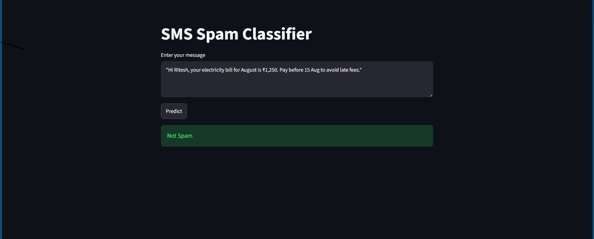
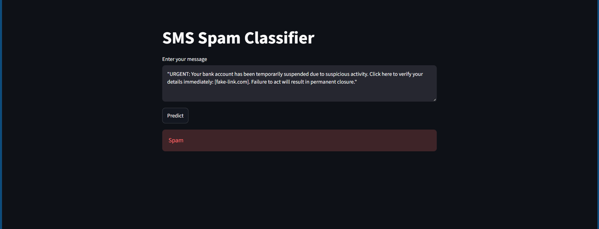

# SMS Spam Classifier

A Machine Learning based SMS Spam Classifier built using Natural Language Processing (NLP) and Streamlit. The application classifies a given SMS message as either **Spam** or **Not Spam** using text preprocessing, TF-IDF feature extraction, and Machine Learning.

---

## Preview

### Prediction Example






---

## Features

* Classify SMS messages as Spam or Not Spam
* Natural Language Processing based text preprocessing
* Stopword removal and punctuation removal
* Porter Stemming
* TF-IDF feature extraction
* Machine Learning classification
* Interactive Streamlit Interface

---

## Tech Stack

* Python
* Pandas
* NumPy
* Scikit-learn
* NLTK
* Matplotlib
* Seaborn
* WordCloud
* Streamlit
* Pickle

---

## Dataset

* SMS Spam Dataset
* Contains Ham and Spam messages

---

## Project Workflow

1. Load the SMS dataset.
2. Remove unnecessary columns and duplicate messages.
3. Encode Ham and Spam categories.
4. Perform text preprocessing using NLTK.
5. Remove stopwords and punctuation.
6. Apply Porter Stemming.
7. Analyze the dataset using visualizations and WordClouds.
8. Convert text into numerical features using TF-IDF.
9. Train Machine Learning classification models.
10. Evaluate models using Accuracy, Precision, and Confusion Matrix.
11. Save the trained model and TF-IDF vectorizer using Pickle.
12. Classify new SMS messages using Streamlit.

---

## Project Structure

SMS-Spam-Classifier/
│
├── app.py
├── main.ipynb
├── dataset.csv
├── model.pkl
├── vectorizer.pkl
├── requirements.txt
├── README.md
├── .gitignore
└── images/
├── homepage1.png
└── homepage2.png

---

## Installation

Clone the repository

```bash
git clone https://github.com/riteshmishra16/SMS-Spam-Classifier.git
```

Move into the project directory

```bash
cd SMS-Spam-Classifier
```

Activate the Conda environment

```bash
conda activate myenv
```

Install the required dependencies

```bash
pip install -r requirements.txt
```

---

## Run the Application

```bash
streamlit run app.py
```

---

## Future Improvements

* Improve model performance
* Add prediction probability
* Add batch SMS classification
* Improve Streamlit Interface
* Deploy the application online

---

## Author

**Ritesh Kumar Mishra**

GitHub: https://github.com/riteshmishra16

LinkedIn: https://www.linkedin.com/in/ritesh-kumar-mishra-234252349/
